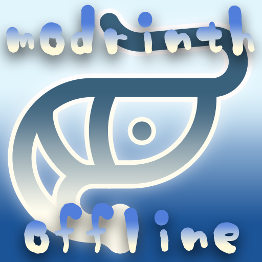

  

# Modrinth App Fork (Portable / Offline Accounts)

A portable fork of the Modrinth desktop launcher with **no ads**, **no Microsoft account required for offline profiles**, and **local/portable storage**.

## Features

- **Portable Only:** Designed to run as a self-contained portable setup rather than a system-wide installation. Keep your launcher and data together in one folder/directory.
- **Offline Accounts Without Microsoft Auth:** Create and use offline profiles locally without signing in with a Microsoft account.
  - *Note:* Offline accounts only work on servers running in offline mode (`online-mode=false`). Accessing official Microsoft/Mojang-authenticated online servers still requires a valid purchased Minecraft account.
- **Ad-Free:** Removes ads from the launcher experience.

## Usage / Portability

1. Extract or place the portable build into your preferred directory (for example, on a dedicated drive or USB storage).
2. Run the executable directly from that folder so instances, profiles, and configs stay contained within your portable setup.
3. Add an offline account from the account manager and launch your instance.

## Important Notes & Limitations

- **Offline Mode Only:** Offline profiles do not authenticate with Mojang/Microsoft session servers. You cannot join `online-mode=true` multiplayer servers with an offline profile.
- **Mod & Content Terms:** Third-party mods, modpacks, shaders, and resource packs remain subject to their respective creators' licenses and terms.

## Disclaimer & Non-Affiliation

- **No Affiliation:** This project is an independent, unofficial fork. It is **not affiliated with, endorsed by, sponsored by, or associated with** Modrinth, Mojang AB, or Microsoft Corporation. All trademarks and brand names belong to their respective owners.
- **Branding & Logos:** While this project has its own custom logo (displayed above), the compiled desktop application itself still uses the upstream Modrinth logo and UI assets. Retaining the original app icon does not imply any official connection to or endorsement by Modrinth.
- **Non-Profit:** This fork is provided strictly free of charge with **no profit**, monetization, paid tiers, donations, or commercial intent.

# Extra logos. 

  

